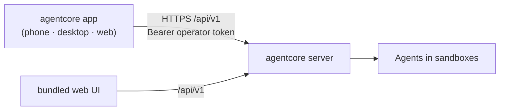

# agentcore app

A Flutter front end for an agentcore server, for phones (Android, iOS), desktops
(macOS, Windows, Linux) and the browser. The agents, sandboxes, policies and
audit log all stay on the server: the app is only a client of the
[operator API](../docs/API.md), signed in with an operator token like the web UI.



## What it does

| Tab | |
|---|---|
| **Sessions** | Active and past sessions, refreshed every few seconds. Start a new session (agent + task). Open one to watch its live event timeline (and the agent's output), approve or reject pending actions, reply when it waits for input, finish, **pause/resume** or **STOP** it, and read its commits and diff. |
| **Inbox** | Everything waiting for a person: agent actions needing approval (across all sessions), outgoing messages in the outbox (send, send back, reject) and proposed releases (approve, request changes, reject). |
| **Organisation** | Departments and their agents, updated live. Start, pause, resume or stop a department or a single agent, pause or resume everything, and read or write the organisation's messages. |

**Stop all** in the top bar stops every running agent. Viewers see everything but
get no controls; operators and admins get the controls their role allows (the
server enforces roles either way).

Configuration (providers, projects, policies, templates, budgets, release
setup) stays in the web UI.

## Connecting to a server

1. Make the server reachable from the device: put a TLS-terminating reverse
   proxy in front of it (see [SECURITY.md](../SECURITY.md)). The app warns when
   you sign in over plain `http://` to anything but a local address.
2. Create an operator token (`agentcore hash-token '...'` → `[[server.operators]]`).
3. In the app, enter the server address (e.g. `https://agentcore.example.com`;
   `https://` is assumed when omitted, and a path prefix such as
   `https://example.com/agentcore` works) and the token.

The address and token are kept in the platform's secure storage (Keychain,
Android Keystore, libsecret; browser storage on the web) until you sign out.
A token the server no longer accepts signs you out.

For a server on your machine during development: `http://127.0.0.1:8080` from
desktop or iOS simulator, `http://10.0.2.2:8080` from the Android emulator.

### Web build

A browser only lets a page call another origin's API if the server allows it.
Serve the web build from its own origin and list that origin on the server:

```toml
[server]
cors_origins = ["https://app.example.com"]
```

Native apps don't need this. The web build polls for session events instead of
holding a server-sent event stream open.

## Development

Requires Flutter (stable, Dart ≥ 3.13).

```sh
cd app
flutter pub get
flutter analyze
flutter test
flutter run            # pick a device; or -d chrome, -d linux, -d macos
```

`test/live_server_test.dart` runs against a real server with the `demo` agent
from `agentcore.dev.toml` (an operator token configured), and is skipped otherwise:

```sh
AGENTCORE_TEST_URL=http://127.0.0.1:8080 AGENTCORE_TEST_TOKEN=... flutter test test/live_server_test.dart
```

Release builds: `flutter build apk` / `appbundle`, `flutter build ipa`,
`flutter build macos|windows|linux`, `flutter build web`.

### Layout

| Path | |
|---|---|
| `lib/api/client.dart` | Operator API client, event and organisation streams (SSE, reconnecting) |
| `lib/api/models.dart` | Typed views of the API's JSON (mirrors `web/src/types.ts`) |
| `lib/api/sse.dart` | Server-sent events decoder |
| `lib/state/app_state.dart` | Server, token and signed-in operator; secure storage |
| `lib/ui/` | Screens |
