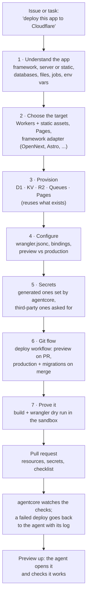
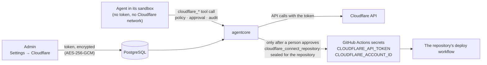

# Deploying to Cloudflare

agentcore can put your applications on Cloudflare. A **Cloudflare deployment
engineer** (the bundled `cloudflare-deployer` role) looks at a repository,
works out what the application is and what it needs, provisions it on
Cloudflare, and sets the repository up for git flow: **a preview for every
pull request, production on every merge**. It delivers all of that as one
pull request that people review like any other.

- [What the agent does](#what-the-agent-does)
- [Setting it up](#setting-it-up)
- [The token and where it goes](#the-token-and-where-it-goes)
- [Tools](#tools)
- [Guardrails](#guardrails)
- [After delivery: previews and build logs](#after-delivery-previews-and-build-logs)
- [A department for deployments](#a-department-for-deployments)
- [Limits](#limits)

## What the agent does

The playbook is in [`roles/cloudflare-deployer.toml`](../roles/cloudflare-deployer.toml).
In short:

1. **Understand the application** before changing anything: framework and
   version, which parts need a server, every database, cache, file store,
   queue, cron job and environment variable it uses, Node.js APIs it relies
   on, and what already exists (a Wrangler file, workflows, resources in the
   account).
2. **Choose how it runs.** Workers with static assets for new applications;
   the right adapter per framework (Next.js with OpenNext, Astro, SvelteKit,
   Nuxt/Nitro, Remix / React Router, Hono); Pages when the repository already
   uses it. Databases map to D1 (or Hyperdrive in front of an existing
   Postgres/MySQL), Redis-style caches to KV, uploads and S3 to R2, jobs to
   Queues, cron to Cron Triggers.
3. **Provision** with the `cloudflare_*` tools. Creating is idempotent: an
   existing database, namespace, bucket, queue or project of the same name is
   reused, never replaced or deleted. Preview and production get separate
   data stores when the data must not mix.
4. **Configure** `wrangler.jsonc` with the real ids, `nodejs_compat` where
   needed, observability on, and an `env.preview` for preview resources.
5. **Secrets** never go into the repository. Random ones the application
   defines itself (session keys, signing keys) are generated and set by
   agentcore without anyone seeing them; third-party ones (Stripe, OAuth) are
   asked for or listed in the pull request's *Before merging* checklist.
6. **Git flow.** A `.github/workflows/deploy-cloudflare.yml` with
   `cloudflare/wrangler-action`: on a pull request, a preview (Workers:
   `wrangler versions upload --preview-alias pr-<n>`; Pages: a branch deploy);
   on a merge to the default branch, D1 migrations and the production deploy.
   Each deploy job declares a GitHub environment with the deployed URL, so
   agentcore finds the preview. Forks get no secrets and no deploy.
7. **Prove it** in the sandbox (`npm ci`, the build,
   `wrangler deploy --dry-run`), then propose the pull request. Its
   description lists every resource and id, which secrets are set and which a
   person must set, and how deploys work.

## Setting it up

1. **Create a Cloudflare API token** (Cloudflare dashboard → *My Profile* →
   *API Tokens* → *Create Token* → custom token):

   | Scope | Permission | Access |
   |---|---|---|
   | Account | Workers Scripts | Edit |
   | Account | Cloudflare Pages | Edit |
   | Account | D1 | Edit |
   | Account | Workers KV Storage | Edit |
   | Account | Workers R2 Storage | Edit |
   | Account | Queues | Edit |
   | Account | Account Settings | Read |
   | Zone | DNS | Edit (only the zones agents may use) |
   | Zone | Workers Routes | Edit |
   | Zone | Zone | Read |

   An account-owned token works too. Leave out what you do not want agents to
   touch: **Test connection** shows which products the token reaches.
2. **Settings → Cloudflare** (admin): the account id (the 32 characters in the
   dashboard's URL) and the token. agentcore checks with Cloudflare that the
   token is active and can read the account before it stores anything.
3. **Settings → GitHub**: the GitHub token also needs **Secrets: read and
   write** on the repositories agents deploy, so `cloudflare_connect_repository`
   can give their GitHub Actions the Cloudflare credentials.
4. **Projects**: start an agent on an issue with the role **Cloudflare
   deployment engineer** (or make it the project's default role), or add the
   *Cloudflare Deployments* department to the organisation and link it to the
   repository.

## The token and where it goes

- The token is stored encrypted like the GitHub token and never enters a
  sandbox, a prompt, a tool result, an event or the audit log.
- Agents act through tools; agentcore makes the API call.
- The token leaves agentcore in exactly one way: when a person approves
  `cloudflare_connect_repository`, agentcore encrypts it for the project's
  repository (a libsodium sealed box with the repository's public key, as
  GitHub requires) and stores it as the Actions secret
  `CLOUDFLARE_API_TOKEN`, next to `CLOUDFLARE_ACCOUNT_ID`. That is what lets
  the repository deploy itself from CI. Give the token no more than deploying
  needs, since the repository's workflows can use it.
- Secret values an agent generates (`generate: true`) are made by agentcore
  and go straight to Cloudflare; nobody sees them. A value an agent passes
  (from a person, in the conversation) is in the conversation and the audit
  log like everything else the agent says.

## Tools

Granted by role capabilities (see [Ways of working](WAYS_OF_WORKING.md#capabilities-and-tools)):

| Capability | Tools |
|---|---|
| `cloudflare:read` | `cloudflare_get_account` (Workers, Pages, D1, KV, R2, Queues, Hyperdrive, zones, workers.dev subdomain), `cloudflare_get_worker` (bindings, deployments, domains, secret names), `cloudflare_get_pages_project` (settings, variable names, deployments), `cloudflare_get_pages_deployment_log`, `cloudflare_list_dns_records`, `cloudflare_list_secrets` (names only) |
| `cloudflare:provision` | `cloudflare_create_d1_database`, `cloudflare_create_kv_namespace`, `cloudflare_create_r2_bucket`, `cloudflare_create_queue`, `cloudflare_create_pages_project` (each returns the existing resource of that name instead of creating a second one) |
| `cloudflare:secrets` | `cloudflare_set_secret` (Worker or Pages project; `generate: true` for a random 256-bit value) |
| `cloudflare:domains` | `cloudflare_create_dns_record` (refuses to replace an existing record), `cloudflare_add_custom_domain` (Worker custom domain, or Pages domain + CNAME) |
| `cloudflare:ci` | `cloudflare_connect_repository` |

There is no tool that deletes anything, and none that deploys from agentcore:
deploys run in the repository's own CI, from git.

## Guardrails

The bundled `default` and `department` policies:

| Rule | Tools | Effect |
|---|---|---|
| `allow-cloudflare-reads` | `cloudflare_get_*`, `cloudflare_list_*` | allowed |
| `approve-cloudflare-changes` | `cloudflare_create_*`, `cloudflare_set_*`, `cloudflare_add_*`, `cloudflare_connect_*` | a person approves each call |
| `allow-wrangler-offline` (`default`) | `npx wrangler deploy --dry-run`, `wrangler types`, `wrangler d1 migrations create`, `opennextjs-cloudflare build`, ... | allowed in the sandbox (they need no account) |

To let a trusted team provision without asking, add an `allow` rule for
`cloudflare_create_*` to a policy of your own (see [Policies](POLICIES.md)).

The role's checks run before the pull request leaves the sandbox: a Wrangler
configuration exists, a workflow deploys with Wrangler, the Wrangler file has
no secret-looking values, and (optional, needs the npm registry) the Worker
builds in a `wrangler deploy --dry-run`.

## After delivery: previews and build logs

agentcore watches every delivered pull request's checks
([Ways of working](WAYS_OF_WORKING.md#after-delivery-checks-and-preview)).
For Cloudflare:

- The deploy workflow's job declares a GitHub environment with the deployed
  URL, so the session gets a **Preview ↗** link and **Review with agent**
  works on the Cloudflare preview.
- A failed deploy job in GitHub Actions goes back to the agent with its log.
- When Cloudflare builds the repository itself (Pages or Workers Builds
  connected to GitHub), a failed check links to the Cloudflare dashboard;
  with Cloudflare connected, agentcore reads that build's log through the API
  and hands the agent the end of it.

## A department for deployments

The *Cloudflare Deployments* department template (category *Build*) has one
core agent, the Cloudflare deployment engineer, working in the
`cloudflare-deployer` role on a linked repository. It keeps
`deployments.md` in the department files: every application, where it runs,
its resources with ids, and anything a person still has to do. It asks
Engineering when an application needs code changes beyond deployment.

## Limits

- **Hyperdrive** configs hold a database password, so agents do not create
  them: a person does, and the agent uses the id.
- A Worker's **secrets** can only be set once the Worker exists, that is,
  after its first production deploy. For a new Worker the agent lists them
  in the pull request (or sets them in a follow-up once it is deployed).
- **Custom domains** need the zone to be in the account already.
- Applications that need long-running processes, native binaries or a full
  Node.js server that cannot be ported are explained on the issue with the
  options (Containers, a port to Hono, ...) instead of forced onto Workers.

API: `GET`/`PUT`/`DELETE /api/v1/integrations/cloudflare`,
`POST /api/v1/integrations/cloudflare/test` (see [API](API.md)).
Configuration: [`[cloudflare]`](CONFIGURATION.md#cloudflare).
