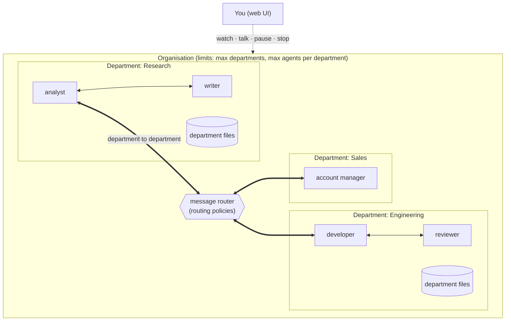
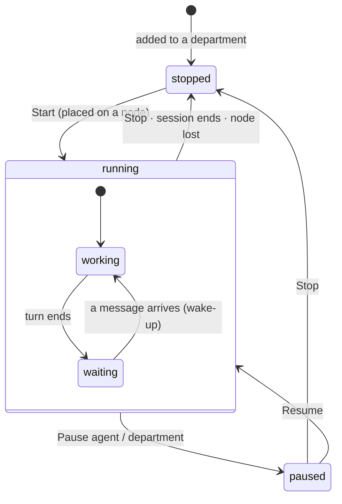
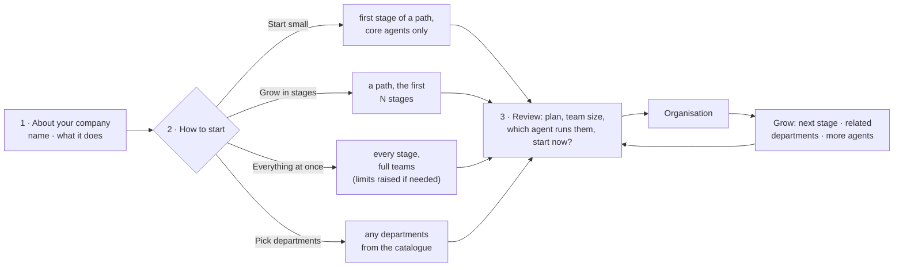
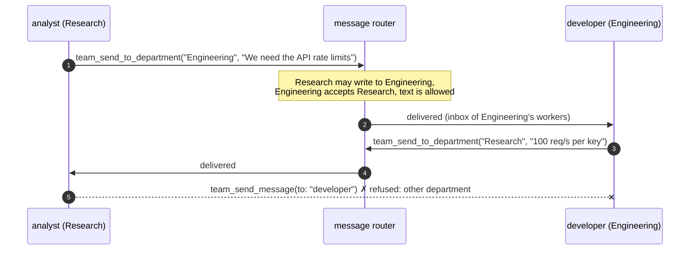
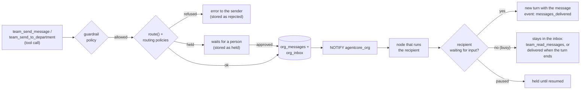
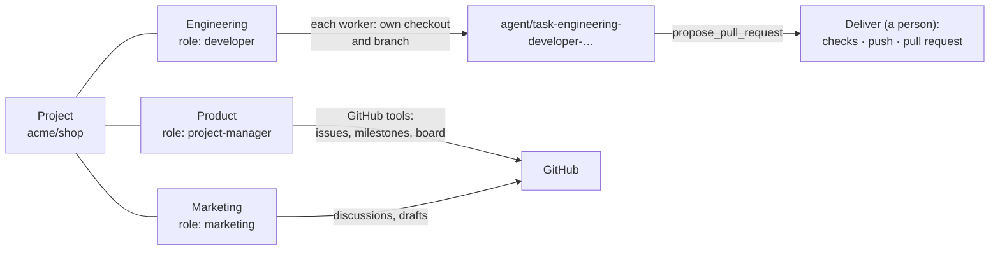
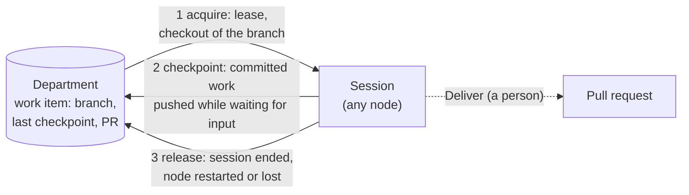
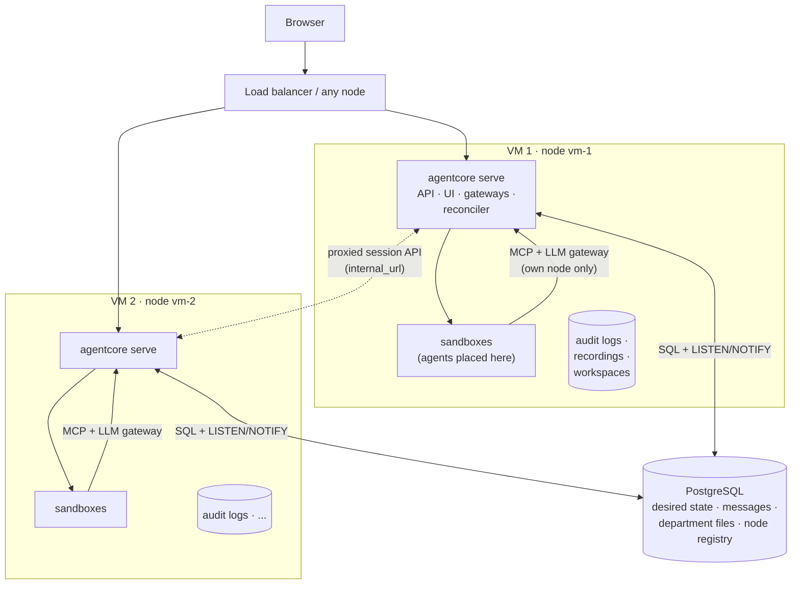
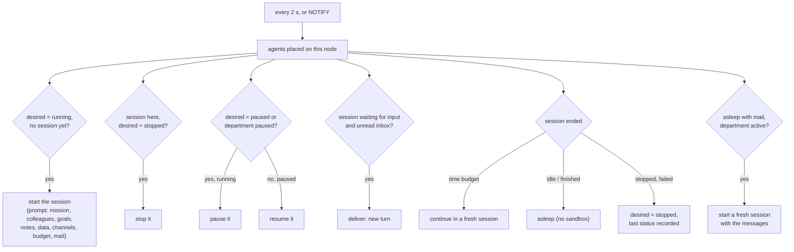

# Multi-agent organisations

agentcore can run many agents together as an **organisation** made of
**departments** (a department is a "room"). Each department has its own
mission, data, tools and guardrails. Agents in the same department work
together. Departments talk to each other only through the organisation's
**message router**, which follows each department's **routing policy**: no
agent sits in between. People can open any department and any agent, see
everything that happens, talk to any agent, and pause or stop one agent, a
department or the whole organisation.

An organisation can run on one VM or be spread over several VMs (**nodes**)
that share one PostgreSQL database.

**At a glance.** Around the departments:

| | What it gives you | Section |
|---|---|---|
| Templates and growth paths | Start with one department or a whole company, grow step by step | [Building an organisation](#building-an-organisation) |
| A linked repository | Departments work on a GitHub project and deliver pull requests | [Working on a repository](#working-on-a-repository) |
| Work items | The department keeps the work: saved to GitHub as it goes, carried on by any worker on any node when a session ends | [Work items](#work-items-the-department-keeps-the-work) |
| Goals and check-ins | Work continues for days: agents sleep when idle, check-ins wake them, sessions continue from notes | [Goals, check-ins and agents that keep going](#goals-check-ins-and-agents-that-keep-going) |
| Business data | Read-only tables, databases and APIs per department | [Business data](#business-data) |
| Dashboard and retrospective | Metrics, signals of waste, and improvements people apply | [Metrics, the retrospective and improvements](#metrics-the-retrospective-and-improvements) |
| Prices, budgets and working hours | Spend in money or tokens; budgets warn or pause the work; departments work at set hours | [Spending and budgets](#spending-and-budgets) |
| The outbox | Email, Slack and webhooks, every message approved by a person | [Talking to the outside world](#talking-to-the-outside-world) |

A step-by-step walkthrough of running an app this way is in the
[Guide](GUIDE.md).

- [Concepts](#concepts)
- [Building an organisation](#building-an-organisation)
- [Writing your own templates](#writing-your-own-templates)
- [Who may talk to whom](#who-may-talk-to-whom)
- [Messages](#messages)
- [Data, tools and guardrails per department](#data-tools-and-guardrails-per-department)
- [Working on a repository](#working-on-a-repository)
- [Goals, check-ins and agents that keep going](#goals-check-ins-and-agents-that-keep-going)
- [Business data](#business-data)
- [Metrics, the retrospective and improvements](#metrics-the-retrospective-and-improvements)
- [Spending and budgets](#spending-and-budgets)
- [Talking to the outside world](#talking-to-the-outside-world)
- [Human oversight](#human-oversight)
- [Limits](#limits)
- [Running on several VMs](#running-on-several-vms)
- [Data model](#data-model)
- [API](#api)
- [Configuration](#configuration)
- [What is not there yet](#what-is-not-there-yet)

## Concepts



| Concept | What it is |
|---|---|
| **Organisation** | Every department on this agentcore installation, across all nodes. |
| **Department** (room) | A group of agents with a mission, its own data (department files, work items, sandbox workspaces), its own tool set and its own guardrail policy. |
| **Worker agent** | A member of one department that does the department's work. It may talk to everyone in its department, and to other departments with `team_send_to_department`. |
| **Message router** | Part of the server, not an agent. It checks every message between departments against the departments' routing policies and delivers it, holds it for a person, or refuses it. No model reads the messages, so nothing can talk it into passing something on. |
| **Routing policy** | Per department: who it may write to and accept from, whether a person approves outgoing messages, limits, blocked phrases and which workers receive incoming messages (see [The message router](#the-message-router)). |
| **Node** | One agentcore process (usually one VM) that runs agent sandboxes. All nodes share PostgreSQL. |
| **Work item** | Work a department does on its repository: a branch, its last checkpoint and its pull request. The department owns it; a session borrows it (see [Work items](#work-items-the-department-keeps-the-work)). |

Every agent is a normal agentcore session underneath: it runs in its own
sandbox, every action goes through policy and possibly a human approval, it
has a hash-chained audit log, a live view and a recording. The organisation
adds membership, messaging and coordinated control on top.

An agent's life:



## Building an organisation

Nobody has to design an organisation from scratch. agentcore ships
**department templates** for the functions businesses usually need and
**growth paths** (blueprints) that add them a few at a time. Everything
created from a template is an ordinary department afterwards: rename it,
change its mission, add or remove agents.



### The catalogue

30 department templates in five groups (`templates/departments/*.toml`):

| Group | Departments |
|---|---|
| Product & engineering | Engineering, Quality Assurance, Platform & DevOps, Security, Product, Design, Data & Analytics, AI & Machine Learning, Technical Writing, Internal IT |
| Growth | Marketing, Content, Developer Relations, Sales, Partnerships, Communications & PR, Community |
| Customers | Customer Support, Customer Success |
| Operations | Operations, Finance, Legal & Compliance, People & HR, Recruiting, Procurement, Supply Chain & Logistics |
| Leadership | Strategy & Leadership, Project Management, Market Research, Retrospective |

Each template has a mission (`{company}` is replaced with the company
name), the tools it needs (engineering-type departments get a sandbox;
business departments get department files), the departments it usually
works with, a "when to add it" hint, and 1–3 agents with instructions. Agents
marked `core` form a **lean** team; a **full** team has all of them.

### Growth paths

| Path | For | Stages |
|---|---|---|
| Solo software engineer | one person building software | Engineering → QA → DevOps, Docs |
| Content & marketing studio | creators, small marketing teams | Content, Marketing → Design, PR, Community → Data, Sales |
| Software product team | a product team | Engineering, Product → Design, QA → DevOps, Security → Data, Docs |
| SaaS startup | a software business | Engineering, Product → Marketing, Support → Sales, Success, Data → Finance, Legal, People |
| Online shop | physical products online | Operations, Marketing, Support → Content, Data, Supply chain → Finance, Procurement, Legal |
| Agency / services company | client projects | Projects, Engineering, Design → Sales, Marketing → Finance, Legal, People |
| Complete company | everything from day one | 5 stages, 27 departments |

### Starting small, growing big

* **Start small**: the first stage of a path with lean teams, e.g. a single
  Engineering department with a tech lead and a developer.
* **Grow in stages**: choose how many stages to create now.
* **Everything at once**: a whole path with full teams. If it does not fit
  the limits, the review says by how much and an admin can raise them in the
  same step.
* **Pick departments**: tick departments in the catalogue.

Afterwards the organisation page shows **suggestions**, most useful first:

1. the **next stage** of the chosen path;
2. **departments that work with the ones you have** (Engineering suggests
   Product, QA, DevOps, Design), with the reason to add them;
3. **more agents** for existing departments (a reviewer for Engineering).

Each one is a click away, and a suggestion that a limit blocks says so.
Admins build departments; operators can add the suggested agents; viewers
see the suggestions.

Teams add their own templates and paths by adding TOML files to
`templates/` (`[templates].dir`); they are validated at startup. See
[Writing your own templates](#writing-your-own-templates).

The company name and description (set in the builder, or with
`PUT /api/v1/org/profile`) are given to every agent at the top of its first
prompt, and `{company}` in template texts is replaced with the name.

## Writing your own templates

Department templates live in `templates/departments/*.toml`; each file holds
any number of `[[departments]]`:

```toml
[[departments]]
id = "engineering"                # unique; blueprints and pairs_with refer to it
name = "Engineering"              # name of the department when created
category = "build"                # build | grow | serve | run | lead
summary = "Designs, builds and maintains the software."
when_to_add = "First, if {company} builds software."   # shown in suggestions
tools = ["sandbox", "files"]      # sandbox and/or files; messaging is always on
policy = "department"             # optional; default: the `department` policy
pairs_with = ["product", "qa"]    # suggested once this department exists
mission = """Build and maintain {company}'s software. ..."""

[[departments.agents]]
name = "lead"                     # a-z 0-9 - _, how colleagues address it
title = "Tech lead"
core = true                       # part of a lean team (at least one per template)
instructions = """..."""
```

Blueprints (growth paths) are one file each in `templates/blueprints/`:

```toml
id = "solo-developer"
title = "Solo software engineer"
level = "starter"                 # starter | growing | complete
focus = "software"                # free text, shown to people
audience = "You build software on your own and want AI colleagues to help."
description = "..."

[[stages]]
title = "Your engineering department"
description = "A tech lead and a developer."
departments = ["engineering"]     # template ids; each at most once per blueprint
```

agentcore refuses to start if a template is invalid: duplicate ids, an
unknown category, tool group, policy or referenced template, an invalid or
duplicate agent name, or a template without a `core` agent. Templates are
only a starting point: departments created from them can be changed freely
and are not updated when the template changes.

## Who may talk to whom

Addressing is decided by one pure function (`agentcore_core::org::route`),
used for every message, from agents and from people alike, and unit tested
rule by rule.

| From ↓ / To → | agent, same dept | own department room | agent, other dept | other department | all departments |
|---|---|---|---|---|---|
| **Agent** | ✅ | ✅ | ❌ | ✅ via the router | ✅ via the router |
| **Human** | ✅ | ✅ | ✅ | ✅ | ✅ |

A message to an agent of another department is refused with an error that
explains the rule ("use `team_send_to_department`"). A message to another
department goes to the [message router](#the-message-router).



## The message router

The router is a function in the server (`agentcore_server::org::send`
with `agentcore_core::decide_route`), not an agent: it uses no model and no
tokens, and it behaves the same every time. Every message **between
departments** passes the **routing policy** of the sending department
(outbound) and of each receiving department (inbound). Messages inside a
department, and messages from people, are not touched by it.

| Rule (per department) | Effect |
|---|---|
| **May write to** | Outbound: the departments it may send to (everyone by default; untick the ones it may not). |
| **Accepts messages from** | Inbound: the departments that may send to it. |
| **Approval** | `none` (default), `broadcast` (only messages to all departments) or `all`: the message is **held** until a person approves or rejects it in the department room or on the organisation page. Approving applies the receiving departments' policies as they are then. |
| **Longest message** | Characters, checked on the sender's and on the receiver's policy. |
| **Messages per hour** | How many messages the department may send to other departments per hour (held ones count, refused ones do not). |
| **Blocked phrases** | Case-insensitive; a message that contains one is refused, sent or received. |
| **Delivery** | Which workers receive incoming messages: all of them (default) or one named worker, who passes it on (all of them if that worker no longer exists). |

A message to all departments is delivered to the departments that accept it;
it is refused only when none does. Every decision is stored with the
message: `status` is `delivered`, `held` or `rejected`, and `decision` says
why or by whom. Refused and held messages show in the feed with that note, and
the sender is told when its message is refused (a held message is reported as
held). The default policy is open: everything is delivered straight away.

Set a policy with the department form (*Message router*) or in the `routing`
field of the department API (`GET /org` shows it):

```json
{
  "routing": {
    "outbound": { "allow": null, "deny": ["<department id>"] },
    "inbound": { "allow": ["<department id>"], "deny": [] },
    "approval": "broadcast",
    "max_message_chars": 4000,
    "max_per_hour": 30,
    "blocked_phrases": ["password", "api key"],
    "delivery": { "mode": "lead", "worker": "lead" }
  }
}
```

People decide on held messages with `GET /org/messages?status=held`,
`POST /org/messages/{id}/approve` and `POST /org/messages/{id}/reject`
(operators). Phrase and size checks catch accidents, not a determined sender:
for anything sensitive, approve messages.

## Messages

Messages are rows in PostgreSQL: the sender, the addressee (an agent, a
department room, or all departments), the scope (`internal`,
`inter_department`, `human`) and the text. When a message is sent, its
recipients are resolved once and an **inbox** entry is written per recipient:

| Addressed to | Recipients |
|---|---|
| an agent | that agent |
| own department room (from a member or a person) | everyone in the department except the sender |
| another department (through the router) | the workers its routing policy picks (all of them by default) |
| all departments (through the router) | the same, in every other department that accepts it |

Delivery to an agent:



* Sending is a tool call, so it goes through the department's guardrail policy
  like any other action. A person can also be made to approve messages that
  leave the department with the routing policy's *approval* rule.
* Delivery is recorded in the recipient's audit log
  (`messages_delivered`, with message ids, senders and texts), so each agent's
  hash chain shows what it was told and by whom.
* An agent that can continue a conversation (opencode, CLI agents with
  `follow_up_args`) waits after each turn and is woken by new messages.
* Loops between agents are bounded by the policy limits of each session
  (`max_actions`, `max_model_calls`, `max_session_secs`).

### Agent tools

| Tool | Available | Purpose |
|---|---|---|
| `team_list_colleagues` | ✅ | ✅ | Members of the own department, their status, and the names of the other departments. |
| `team_send_message` | always | `to`: a colleague's name or `everyone` (the department room). |
| `team_read_messages` | always | Unread messages from the inbox (marks them delivered). |
| `team_send_to_department` | always | `department`: a department name or `all`. The router may refuse it or hold it for a person. |
| `team_list_files`, `team_read_file`, `team_write_file` | if the department grants `files` | The department's shared files. |
| `team_list_goals` | always | The organisation's goals with their latest progress. |
| `data_list_sources`, `data_query` | if the department was granted a data source | Read-only business data (see [Business data](#business-data)). |
| `outbox_channels`, `outbox_draft`, `outbox_drafts`, `outbox_revise` | if the department may use a channel | Drafts for the outside world that people approve (see [Talking to the outside world](#talking-to-the-outside-world)). |
| `insights_metrics`, `insights_org`, `insights_messages`, `insights_proposals`, `insights_propose`, `insights_revise` | if the department grants `insights` | The retrospective: metrics, structure, messages, and proposals (see [below](#metrics-the-retrospective-and-improvements)). |
| `team_report_progress` | always | `goal` (id or title), `text`: replaces the goal's latest progress note. |
| `team_work_item`, `team_finish_work_item` | with a checkout (see [Work items](#work-items-the-department-keeps-the-work)) | The worker's work item (optionally renamed with `title`); close it when done (`summary`). |
| `team_list_work_items`, `team_assign_work_item` | in a department with a repository | The department's open work items; hand one (`item`: id or title) to a worker (`to`), yourself included. |
| `run_command`, `read_file`, `write_file`, `list_files` | if the department grants `sandbox` | Commands and files in the agent's own sandbox. |

The tool list an agent sees *is* its permission: a tool that is not offered is
also refused if called.

## Working on a repository

A department can work on a **project**: a GitHub repository set up under
Projects (see [Ways of working](WAYS_OF_WORKING.md)). Link it when creating
or editing the department, or choose the repository in the builder: then
every new department whose template has a role on a repository is linked.

A project can be linked, changed or removed at any time. Agents see the
current state in real time through `team_project` (repository, branch, role,
whether a checkout is set up in their session). The checkout and GitHub tools
are prepared on the host before a session starts, so running workers are
restarted into a fresh session, with a note saying why, as soon as they are
idle after the change.

**Holding a team without a repository.** Tick *Its agents need a repository
to work* on a department (departments built from a template with a role on a
repository have it on). Until a project is linked, its workers are paused
and the department shows *waiting for a GitHub repository to be linked*;
`team_project` tells them why. Linking one resumes them. Whenever an admin
edits a department (repository, role, tools, mission, policy), everyone in it
receives a message saying what changed and by whom, which a paused agent
reads when it carries on. To stop a whole team for any other reason, pause the
department (or everyone); changes made meanwhile reach it the same way.



What a worker in a linked department gets:

| | With the `sandbox` tool group | Without |
|---|---|---|
| Checkout | A clone of the repository on the branch of its [work item](#work-items-the-department-keeps-the-work): a new branch `agent/task-<department>-<agent>-<id>` from the base branch for new work, or the item's branch as last saved when it carries work on. Prepared on the host before the agent starts | none |
| GitHub tools | Those of the department's role (default: the project's role): developer → read issues, comment, propose a pull request; project-manager → manage issues, milestones and the board; marketing → discussions | same |
| First prompt | The role's playbook, the team's convention files from the repository (`CONTRIBUTING.md`, `AGENTS.md`, ...), the project's notes, the role's checks, then the department part (mission, colleagues, the repository and how to deliver) | the role's playbook and the project's notes, then the department part |
| Delivery | When the agent proposes a pull request, a person clicks **Deliver** in its session: the role's checks run, the branch is pushed with agentcore's GitHub credentials, the pull request is opened | – |

Nothing reaches GitHub without
passing the department's policy: GitHub writes need approval under the
`department` and `default` policies, and code only leaves the sandbox
through a delivery a person starts. Department templates for code-heavy
functions (Engineering, QA, DevOps, Security, Data, AI/ML, Technical
Writing) use the `default` policy, which allows the usual development tools
in the sandbox.

### Work items: the department keeps the work

A worker's work on the repository belongs to its department, not to its
sandbox. Each piece of work is a **work item**: a branch on GitHub, its last
checkpoint, and its pull request once delivered. A session *borrows* the item
through a lease; when the session ends, for whatever reason, the item stays
with the department and is carried on from its last checkpoint.



1. **Acquire.** When a worker's session starts, it takes the lease on the
   item it carries on (its most recently updated open item nobody holds), or
   on a new item with a new branch from the base branch. A carried-on item
   is checked out as last saved on GitHub; the prompt says so, with the last
   commit and what happened to the previous session. Only one session holds
   an item at a time.
2. **Checkpoint.** While the agent waits for input, its node pushes the
   *committed* work to the item's branch whenever it changed (every
   `[cluster].checkpoint_secs`, default 60), and once more when the system
   ends the session for its time limit or for idleness. Uncommitted changes
   are not saved; agents are told to commit often. A person's **STOP** does
   not wait for a save.
3. **Release.** When the session ends, its node restarts or its node is
   lost, the lease is released and the item keeps its last checkpoint.
   **Continue** (time limit), **wake** (a message) and a restart start the
   next session on the same item.

Who carries the work on:

| The session ended because | What happens to the work |
|---|---|
| its time limit, or it slept and was woken | the same worker carries the item on in its next session |
| its node restarted | the node starts the worker again at once, on the item |
| its node was lost | another node notices (heartbeat), releases the lease and places the worker on a live node, which carries the item on |
| a person stopped it, or it failed | the item waits; it is carried on when the worker is started again, or a person or a colleague hands it to another worker |

**Fencing.** Each acquisition gets a new lease generation. Checkpoints and
delivery push only while the session still holds the lease, and only over the
branch's last checkpoint (`--force-with-lease`), so a session that lost its
item (for example on a node cut off from the others) cannot overwrite newer
work: its push and its delivery are refused.

**Handing work over.** A worker sees its item with `team_work_item` (and
names it after what it does). When the item is delivered and done, it closes
it with `team_finish_work_item`, and its next session starts a new one. Workers
list the department's items and hand one to a worker (themselves included)
with `team_assign_work_item`; people do the same in the department room (*Work
items*: hand to, close). An item a session works on cannot be handed over or
closed by others; the new worker gets a message and carries the item on in
its next session.

Delivery is unchanged: a person clicks **Deliver**, the role's checks run,
the item's branch is pushed and the pull request opened or updated; the item
records it, so addressing review comments later, in any session, updates the
same pull request.

## Goals, check-ins and agents that keep going

An organisation can work towards goals over days and weeks without a person
writing to it every time. Three things make that possible.

**Goals.** People set the organisation's goals ("Reach 10 paying customers
by March"), optionally owned by one department. Every agent sees the active
goals in its prompt; workers read them with `team_list_goals` and report
progress with `team_report_progress` (the latest note, who wrote it and when
are shown with the goal). Only people mark a goal *achieved* or *dropped*.

**Check-ins.** A check-in is a message sent on a schedule (every hour, day,
week, ...) to one agent or to everyone in a department, from
`check-in: <name>`. It wakes sleeping agents and tells them what to do, for
example the daily check-in: *"Read the goals, your notes and new messages.
Decide the most valuable next step towards the goals, do it, update your
notes, and report progress."* Every node runs the scheduler; each due
check-in is claimed by exactly one node (row lock with `SKIP LOCKED`), so it
is sent once. A check-in that was due several times while nothing ran (all
nodes down) is sent once and continues from now. People can run a check-in
now, turn it off, or delete it.

**Sleep, wake and continue.** An agent started by a person stays wanted
(`desired = running`) until a person stops it. When its session ends:

| The session ended because | The agent |
|---|---|
| nobody wrote to it within `idle_timeout_secs`, or a single-run agent finished | **sleeps** (`status = asleep`): no session, no sandbox, no cost. The next message (from a colleague, a person or a check-in) wakes it in a fresh session with the messages in its prompt. |
| it reached `max_session_secs` | **continues** at once in a fresh session (in a paused department: sleeps until resumed). |
| a person stopped it, it failed, ... | is stopped, as before. |

A fresh session starts from the agent's notes: workers with department files
keep `notes/<agent>.md` (what they are working on, decisions, next steps),
and the prompt of a continued or woken session says *"You are continuing"*
and asks the agent to read its notes and recent messages first. On a linked
repository it carries its [work item](#work-items-the-department-keeps-the-work)
on: its checkout continues from the item's last checkpoint. Sleeping agents survive a node restart
(they have nothing running); pausing or stopping works on them as on any
agent.

To stop a loop (an agent that ends at once and is woken again, two agents
waking each other), a node starts one agent automatically at most 6 times an
hour; after that the agent is stopped with a note. Starting it by hand
resets the count. Time budgets, model-call limits and the policy still apply
to every session.

The builder can set both up: *A goal for the organisation* creates the first
goal, and *Keep it running* adds a daily check-in for the lead of each new
department and a weekly review in Strategy.

## Business data

Departments that steer the company need facts: revenue, sign-ups, usage,
support tickets. An admin adds **data sources** under *Organisation →
Business data* and ticks the departments that may read each one:

| Kind | What agents do | Configure |
|---|---|---|
| **Table** | read an uploaded CSV with `filter` (`{column: value}`), `contains`, `columns`, `limit`, `offset` | the file (≤ 5 MB, first row = column names) |
| **PostgreSQL** | run one `SELECT` (`sql`) | a connection string, ideally of a user that can only read |
| **HTTP API** | `GET` a `path` below the base URL | base URL, header name and value (e.g. `Authorization: Bearer …`), optional allowed path prefixes, a path for *Try it* |

Workers of a granted department get `data_list_sources` and `data_query`,
and their prompt lists the sources with their descriptions. Guarantees:

* **Read-only.** SQL runs in a `READ ONLY` transaction with a 15 s statement
  timeout, one statement only, wrapped so at most `max_rows` (default 200,
  at most 1000) rows come back; the transaction is rolled back. HTTP
  sources only `GET`, never follow redirects (the key cannot be sent
  elsewhere) and return at most 256 KB. Tables are read in memory.
* **Secrets stay on the server.** Connection strings and API keys are
  encrypted with the master key (like provider keys) and never shown to
  agents or in the API (only a hint like `…ales`).
* **Grants are checked on every call**, so taking a department off a source
  (or turning the source off) takes effect at once.
* **Every query is recorded** (`org_activity`, kind `data_query`) and shows
  up in the metrics; the tool call itself is in the session's audit log.

Admins can *Try it* with their own query before granting a source.

## Metrics, the retrospective and improvements

### Metrics

*Organisation → Dashboard* shows how the organisation did over the last 7,
14 or 30 days, all measured from what agents did:

* figures: agents working and asleep, agent-hours (time sessions ran),
  tokens and model calls, messages (and between departments), the average
  wait until a message reached its recipient, goals with progress, applied
  improvements;
* per day: sessions, messages, tokens, model calls, failed sessions, denied
  actions;
* per department and per agent: sessions, failures, agent-hours, tokens,
  messages sent and received, waiting messages, denied actions, approvals
  and how long they waited, progress reports, data queries, last activity;
* goals: on track, slowing (no progress for a week) or stalled (two weeks).

Sessions, model calls and messages come from their tables; denied actions,
approvals (with their waiting time), goal progress reports and data queries
are recorded in `org_activity` as they happen. `GET /org/metrics?days=`
returns the same numbers.

### Signals

Patterns that usually mean waste are listed first, most severe first, each
with what usually helps:

| Signal | When |
|---|---|
| messages pile up | ≥ 5 messages wait in a department whose agents are all stopped |
| failing agent | ≥ 2 failed sessions and at least half of its sessions |
| stale goal | an active goal without progress for 7 days (high after 14) |
| idle department | workers, but no sessions, no messages and no check-in in the period |
| slow responses | messages wait more than an hour on average |
| policy mismatch | ≥ 5 denied actions in a department |
| slow approvals | approvals wait more than an hour on average |
| spend without output | an agent used > 200K tokens or > 8 agent-hours but sent no messages |

*Ask for a fix* sends the signal to the retrospective agent.

### The retrospective

A department granted the **`insights`** tool group (the *Retrospective*
template: one agent, `retro`, and a daily check-in) watches the whole
organisation. Its workers can read the metrics and signals
(`insights_metrics`), the structure with ids, policies and agents
(`insights_org`), any department's messages (`insights_messages`) and the
proposals (`insights_proposals`). They change nothing themselves: they
**propose** (`insights_propose`) with

* the **problem** (what is inefficient), the **evidence** (numbers), the
  **solution**,
* and the **changes** that apply it, from a closed set:

| Change | Fields | Needs |
|---|---|---|
| `update_instructions` | `agent`, `instructions` | operator |
| `control_agent` | `agent`, `control` (`start`/`pause`/`resume`/`stop`) | operator |
| `create_check_in` | `department`, `agent`?, `name`, `message`, `every_minutes` | operator |
| `update_check_in` | `check_in`, `message`?, `every_minutes`?, `enabled`? | operator |
| `create_goal` | `title`, `description`?, `department`? | operator |
| `send_message` | `department` or `agent`, `text` | operator |
| `set_budget` | `department`?, `period` (`day`/`week`/`month`), `limit` (currency), `action` (`warn`/`pause`) | admin |
| `add_agent` | `department`, `name`, `agent`?, `instructions` | admin |
| `remove_agent` | `agent` (stopped first) | admin |
| `update_department` | `department`, `mission`?, `policy`?, `tools`? | admin |
| `set_limits` | `max_departments`?, `max_agents_per_department`? | admin |

References are checked when the proposal is made and again when it is
applied.

### Deciding

*Organisation → Improvements* lists the proposals. For each, a person can:

* **Apply** it: the changes run in order, in the name and with the
  permissions of that person (a viewer cannot apply; admin-only changes
  need an admin). The first change that fails stops the rest; the result
  of each change is shown. Applying names the revision the person reviewed,
  so a proposal revised in the meantime is not applied by surprise (`409`),
  and two people applying at once apply it once.
* **Change it**: edit the texts and the changes; it becomes a new revision
  (the old one is kept in the history), then apply it.
* **Send it back** with what should change: the proposer gets a message,
  wakes up and revises it (`insights_revise`).
* **Reject** it, with a reason the proposer is told so it does not propose
  it again.

The proposer is told when its proposal is applied (or a change failed), so
it can check in the metrics whether the change helped.

**Apply without asking.** An admin can tick kinds of change (for example
*Add a goal*, *Change a check-in*) under *Apply without asking*. A proposal
from an agent whose changes are all of ticked kinds is applied at once, in
the name of "auto-apply (allowed by <admin>)". Everything else waits for a
person.

## Spending and budgets

*Organisation → Spending* shows what model calls cost and limits it.

**Prices.** An admin sets the price per million input and output tokens per
provider and model: an exact model name, a prefix ending in `*`
(`claude-sonnet-*`), or `*` for every model of the provider; the most
specific price wins. Every call through the model gateway is **priced when
it is recorded** (`model_calls.cost_micros`, millionths of the currency), so
a later price change does not rewrite history. Calls made before a price
existed can be priced afterwards (*Price them with the current prices*).
The currency is a label set once (default `USD`).

**Budgets.** A budget limits the spending of the whole organisation or one
department per calendar day, week (from Monday) or month, in UTC. A budget
counts **money** (the default) or **tokens** (input plus output, whatever the
model costs, so it works without prices). Each scope has at most one budget
per period and unit; setting it again replaces it. A scope can have a money
and a token budget at once: whichever runs out first applies. For a token
budget `limit_micros` is a token count. Admins can change a budget's limit,
warning level and action at any time (*change limit*, *only warn* / *pause
when used up*); a raised limit resumes what the budget paused at once.

| | `warn` | `pause` |
|---|---|---|
| At `warn_percent` (default 80 %) | people see a warning on the dashboard | the same |
| At the limit | people see it was used up | the departments in scope are **paused** (marked as paused by the budget) and the model gateway **refuses** their calls with `403` and the reason |
| Next period, or a higher limit | — | the departments the budget paused are resumed (unless a person changed them since) and calls go through |

Each node checks budgets on its heartbeat (every `heartbeat_secs`); each
step (warn, pause, resume) is claimed by exactly one node. The gateway reads
the usage with at most 5 seconds of delay, so the calls in flight when a
limit is reached can take the spending slightly over it. Resuming a paused
department by hand does not lift the block: raise the limit or wait for the
next period.

Agents covered by a budget see it in their prompt (*Budget: 2.10 of 5.00
EUR used this month*) and are asked to work economically. Costs appear per
day, department and agent on the dashboard, and the retrospective sees them
too: it can propose a `set_budget` change (admin to apply), and signals warn
when a budget is nearly or fully used, or when tokens are used without
prices.

**Working hours.** *Spending → Working hours* sets when each department
works: one or more windows of weekdays and a start and end time (`HH:MM`) in
a timezone (an IANA name such as `Europe/Berlin`). An end before the start
runs past midnight into the next day. Without a schedule, or with it turned
off, a department works at any time. Each node checks the schedules on its
heartbeat: when the hours end the department is **paused** (marked as paused
by the hours) and the model gateway **refuses** its calls with `403`; when
they begin it is resumed. The hours never resume a department a person or a
budget paused, and a used-up budget keeps a department paused until it has
room again. The schedule is enforced on every heartbeat, so a department
resumed by hand outside its hours is paused again: change the hours or turn
them off instead.

## Talking to the outside world

Agents reach people outside the organisation (customers, leads, partners,
the team's chat, social media) only through **channels** an admin sets up
under *Organisation → Outbox*, and only by **drafting**: a person approves
every message before it is sent.

| Kind | Sends | Configure |
|---|---|---|
| **Email** | over SMTP | host, port, security (`starttls`, `tls`, or `none` for a local relay), user and password (secret), `from`, optional `reply_to`, optional allowed recipient domains, at most `max_recipients` (default 10) |
| **Slack** | to an incoming webhook | the webhook URL (secret) |
| **Webhook** | a JSON `POST` (`message_id`, `channel`, `recipients`, `subject`, `text`, `body`, `disclosure`, `drafted_by`, `approved_by`, `ai_generated: true`) | URL, optional header and value (secret). Connects Zapier, Make, n8n or your own service, for social media, a CRM, SMS, ... |

Each channel lists the departments that may use it, a **daily limit**
(default 50 messages, enforced even for approved messages), and a
**disclosure** appended to every message (default *This message was written
by an AI agent.*). Secrets are encrypted and never shown to agents; HTTP
channels never follow redirects. *Send a test* checks the settings.

**Agents** of a granted department get `outbox_channels` (the channels and
their rules), `outbox_draft` (`channel`, `to`, `subject`, `text`),
`outbox_drafts` (their drafts with status, feedback and errors) and
`outbox_revise`; their prompt lists the channels and asks for accurate,
final text without invented facts, prices or promises. Recipients are
checked when the draft is made (allowed domains, how many).

**People** see the drafts in the Outbox and, for each one:

* **Approve & send** the revision they read (a draft revised in the
  meantime is refused with `409`; two people approving at once send it
  once);
* **Edit** recipients, subject or text first (a new revision; the history
  keeps every version);
* **Send back** with what should change: the agent is told, wakes up and
  revises it;
* **Reject** it, with a reason the agent is told;
* **Retry** a message whose sending failed (the error is shown).

The agent gets a message about every decision. A channel can be set to
**send without approval** (for example an internal Slack channel): drafts
then go out at once, up to its daily limit; beyond it they wait for a
person. Drafts waiting more than a day and failed messages appear among the
dashboard's signals.

## Shipping releases

A department that builds software can ship it. An admin creates a
**product** (Organisation → 🚀 Releases → + Product) and names the
departments whose agents may propose releases; their workers get the
`release_*` tools and a "Releasing software" section in their prompt.
Agents propose a version with notes, artifacts and their SHA-256 digests;
the server scores the risk from facts and adapts the rollout; people approve
after the server verified every artifact; the release goes out in stages,
and health gates on client reports or business data roll it back on their
own. Agents hear about every step and can halt a rollout, never start or
advance one. See [Releases and distribution](RELEASES.md).

Departments that **announce** a product (marketing, content, developer
relations) get a launch brief when a release reaches everyone, `launch_*`
tools for the facts, tracked links and results, and draft the
announcements into the outbox. See
[Telling people about it](RELEASES.md#telling-people-about-it).

## Data, tools and guardrails per department

| | Set per department | Enforced by |
|---|---|---|
| **Mission** | Text given to every agent of the department in its first prompt. | Prompt |
| **Tools** | `sandbox` (commands and files in the agent's own sandbox), `files` (department files) and/or `insights` (the organisation's metrics and proposing improvements). Messaging is always available. | Tool gateway (`tools/list` and `tools/call`) |
| **Data** | Department files: a small shared file store (PostgreSQL, so every node sees it) that only that department's workers can read and write. Each worker also has its own sandbox workspace. [Business data](#business-data) sources granted to the department, read-only. | Gateway: the department is taken from the agent's identity, never from tool arguments |
| **Guardrails** | A policy (allow / deny / require approval, limits) for its workers. Messages between departments also follow the [routing policy](#the-message-router). | Policy engine, per action |
| **Agent kind** | Which configured `[[agents]]` (e.g. `opencode`) each member runs, plus member-specific instructions. | Runtime |

## Human oversight

Everything a person can do, at every level:

| | Agent | Department | Organisation |
|---|---|---|---|
| **See** | Live view, timeline, model calls, approvals, audit log (the existing session view) | Room: all members with status, every message in and out, department files | Overview: all departments, all agents, node health, organisation-wide message feed |
| **Talk** | Message an agent (wakes it) | Post in the department room (every member receives it) | Message any department |
| **Pause / resume** | ✅ | ✅ every agent in it, and new starts wait | ✅ (`Pause all`) |
| **Stop** | ✅ | ✅ every agent in it | ✅ **Stop all agents** (on every node) |
| **Decide** | Approvals of its risky actions | Its drafts in the outbox (approve, edit, send back, reject) | Improvements the retrospective proposes; auto-apply allowances |
| **Limit** | Policy limits (time, actions, model calls) | Tools, data sources, channels, budget | Department and agent limits, organisation budget, channel daily limits |
| **Measure** | Model calls and cost | Dashboard row: sessions, cost, waiting, denials, approvals | Dashboard, signals, spending per day |

Pause and stop are recorded with who did it, in the audit log of every
affected agent and in the admin log. So are decisions on proposals and
outbox messages, budget and price changes, data sources and channels.

## Limits

An admin sets, in the UI (Organisation → Limits) or with
`PUT /api/v1/org/settings`:

* `max_departments`: how many departments may exist;
* `max_agents_per_department`: how many worker agents a department may
  have.

They are checked inside the same database transaction that creates the
department or agent (with a row lock on the settings), so two people adding
agents at the same time on different nodes cannot exceed them. Lowering a
limit does not remove anything; it only blocks new additions. In addition,
each node has a capacity (`[cluster].max_agents`): the number of agents it
runs at the same time.

## Running on several VMs

Every VM runs the same `agentcore serve` binary with its own
`[cluster].node_name`. All nodes use one PostgreSQL database. There is no
separate control-plane process: any node can serve the web UI and the API.



### Principles

1. **PostgreSQL holds the desired state; nodes converge to it.** Starting,
   pausing and stopping an agent or a department only *writes* what should be
   true (`org_agents.desired`, `departments.state`). Each node runs a
   **reconciler** that compares that with the sessions it runs and acts.
   A `NOTIFY agentcore_org` wakes every node's reconciler at once; a periodic
   pass (every 2 s) catches anything a dropped connection missed. So commands
   are level-triggered: a missed notification delays a command, it never loses
   it.
2. **A session is owned by exactly one node**, the one it was placed on. Its
   sandbox, audit log, recording and the agent's gateways live there. The
   agent only ever talks to its own node.
3. **Any node answers any request.** Session endpoints
   (`/api/v1/sessions/{id}/...`: details, events, live view, pause, stop,
   approvals, audit) are forwarded to the owning node's `internal_url`,
   including streams (SSE). The caller's token is forwarded and checked again
   by the owner, so every node needs the same `[[server.operators]]`.

### Placement

When an agent is started, the node handling the request picks a node inside
one transaction (with an advisory lock, so concurrent starts do not
overbook): among nodes whose heartbeat is fresh, the one with the lowest
load = running agents ÷ `max_agents`, skipping full nodes. No free node →
`503`. The agent row records the node; only that node's reconciler starts the
session.

### Reconciler (per node)



Automatic starts (continue, wake) are limited to 6 per agent per hour; past
that the agent is stopped with a note, to stop loops.

### Heartbeat (per node)

Every `heartbeat_secs` each node, besides reporting that it is alive:

1. marks the agents of nodes that stopped responding as stopped;
2. checks the **budgets** (warn, pause, resume; see
   [Spending and budgets](#spending-and-budgets));
3. sends the **check-ins** that are due.

Each of these is claimed in PostgreSQL by exactly one node, so with several
nodes nothing happens twice; with one node, the same loop does it all.

### Failure handling

| What fails | What happens |
|---|---|
| A node crashes or loses the database | Its heartbeat goes stale (`node_timeout_secs`). Any other node marks that node's agents `stopped` (status `failed`, "node lost") and releases the work items their sessions held. Workers with open work items are placed on a live node at once and carry their items on from the last checkpoint: their work is in the department, not in the lost sandbox. Other agents are not restarted elsewhere; a person starts them again. |
| A node restarts | Its interrupted sessions are closed in their audit logs (`session_ended`, interrupted) and its leftover sandboxes are removed. Only its *own* sessions: other nodes' live sessions are untouched. Agents that were **asleep** stay asleep (nothing was running) and wake on their next message; workers that held a work item start again on it; other agents that were working are marked stopped ("interrupted: its node restarted"). |
| A node is cut off but its sessions run on | Their work items are released and carried on elsewhere; the cut-off sessions' checkpoints and deliveries are refused (lease generation, `--force-with-lease`), so they cannot overwrite the newer work. |
| A budget runs out | `pause` budgets pause the departments in scope and the model gateway refuses their calls; they resume when the period ends or the limit is raised. |
| An outward channel fails | The message is marked `failed` with the error; people fix the channel and retry it. Nothing is retried automatically. |
| Several nodes run the heartbeat | Check-ins, budget steps, proposal and outbox decisions are claimed with conditional updates (`SKIP LOCKED`, revision checks): each happens once. |
| A NOTIFY is lost | The periodic reconcile pass applies the change within 2 s. |
| The owning node is unreachable when a session page is opened | `503 node <name> is unreachable`; the organisation views (served from PostgreSQL) keep working. |
| Stop all agents | Writes `desired = stopped` for every agent and broadcasts `stop_all`; every node also stops sessions that do not belong to an organisation. |

### Security between nodes

* Nodes talk to each other only to forward session API calls, to
  `internal_url`, which should be on a private network. The forwarded request
  carries the operator's own token; the owner authenticates it again.
* Agents never reach another node: their gateway URL and token are those of
  their own node.
* PostgreSQL is the trust anchor: whoever can write to it can direct agents.
  Use TLS and a dedicated database user.
* `data/master.key` (or `$AGENTCORE_MASTER_KEY`) must be the same on every
  node, so each node can decrypt provider keys.

### Sizing

PostgreSQL `LISTEN/NOTIFY` and the 2 s reconcile pass are cheap at the scale
the limits allow (tens of departments × tens of agents). Payloads are only
nudges (`{"kind":"message","agents":[...]}`); the data is read with
indexed queries. The bus is one module (`cluster.rs`), so a dedicated broker
(NATS, Redis streams) can replace it if organisations grow far beyond that.

## Data model

```mermaid
erDiagram
    org_settings {
        int max_departments
        int max_agents_per_department
        text company_name
        text company_about
        text blueprint
    }
    departments ||--o{ org_agents : "members"
    departments ||--o{ department_files : "shared data"
    departments ||--o{ work_items : "work on its repository"
    org_agents ||--o{ work_items : "carries on"
    sessions ||--o| work_items : "holds the lease"
    org_agents ||--o| sessions : "current session"
    org_messages ||--o{ org_inbox : "one per recipient"
    org_agents ||--o{ org_inbox : "inbox"
    nodes ||--o{ org_agents : "placed on"
    nodes ||--o{ sessions : "owns"
    departments ||--o{ org_goals : "owns (optional)"
    org_proposals }o--o| org_agents : "proposed by"
    departments ||--o{ budgets : "limits (or the whole org)"
    org_channels ||--o{ org_outbox : "drafts and messages"
    org_agents ||--o{ org_outbox : "drafted by"
    departments ||--o{ org_schedules : "check-ins"
    org_agents ||--o{ org_schedules : "addressed to (optional)"

    departments {
        uuid id PK
        text name UK
        text mission
        text policy
        text_array tools
        jsonb routing_policy "message router rules"
        text state "active | paused"
        text template "created from"
        uuid project_id FK "works on"
        text role "role on the repository"
    }
    org_agents {
        uuid id PK
        uuid department_id FK
        text name
        text kind "worker"
        text agent "configured [[agents]]"
        text instructions
        text desired "stopped | running | paused"
        text node FK
        uuid session_id
        text status "... | asleep"
        text note
        text changed_by
    }
    org_goals {
        uuid id PK
        text title
        text description
        uuid department_id FK
        text status "active | achieved | dropped"
        text progress "latest note"
        text progress_by
        timestamptz progress_at
    }
    data_sources {
        uuid id PK
        text name UK
        text kind "postgres | http | table"
        jsonb config "base_url, header, paths, max_rows, rows"
        bytea secret_ciphertext "encrypted"
        uuid_array departments "may read it"
        bool enabled
    }
    org_activity {
        bigint id PK
        timestamptz at
        uuid department_id
        uuid agent_id
        text kind "denied | approval | progress | data_query"
        bigint value "approval wait (ms)"
        text detail
    }
    org_proposals {
        uuid id PK
        text title
        text problem
        text evidence
        text solution
        jsonb actions "the changes"
        text status "open | changes_requested | applied | rejected | failed"
        int revision
        jsonb history
        text feedback
        uuid proposer_agent FK
        text decided_by
        jsonb result
    }
    org_channels {
        uuid id PK
        text name UK
        text kind "email | slack | webhook"
        jsonb config
        bytea secret_ciphertext "encrypted"
        uuid_array departments
        bool requires_approval
        int max_per_day
        text disclosure
    }
    org_outbox {
        uuid id PK
        uuid channel_id FK
        uuid agent_id FK
        text_array recipients
        text subject
        text body
        text status "pending | changes_requested | sending | sent | rejected | failed"
        int revision
        jsonb history
        text decided_by
        timestamptz sent_at
        text error
    }
    budgets {
        uuid id PK
        uuid department_id FK "null: whole organisation"
        text period "day | week | month"
        bigint limit_micros
        text action "warn | pause"
        int warn_percent
        timestamptz warned_period
        timestamptz exhausted_period
        uuid_array paused_departments
    }
    model_prices {
        text provider PK
        text model PK "name, prefix*, or *"
        numeric input_per_mtok
        numeric output_per_mtok
    }
    org_schedules {
        uuid id PK
        uuid department_id FK
        uuid agent_id FK "null: whole department"
        text name
        text message
        int every_minutes
        timestamptz next_run_at
        timestamptz last_run_at
        bool enabled
    }
    org_messages {
        uuid id PK
        text from_kind "human | agent"
        uuid from_agent
        uuid from_department
        text to_kind "agent | department | all_departments"
        uuid to_agent
        uuid to_department
        text scope
        text status "delivered | held | rejected"
        text decision "why, or who decided"
        text text
    }
    org_inbox {
        uuid message_id PK
        uuid agent_id PK
        timestamptz delivered_at
    }
    department_files {
        uuid department_id PK
        text path PK
        bytea content
    }
    work_items {
        uuid id PK
        uuid department_id FK
        uuid project_id FK
        text branch "holds the work between sessions"
        text head_commit "last checkpoint"
        text state "open | closed"
        uuid assignee FK "carries it on"
        uuid lease_session "session holding it"
        text lease_node
        bigint lease_generation "fences stale sessions"
        text pull_request_url
    }
    nodes {
        text name PK
        text internal_url
        int capacity
        timestamptz last_seen
    }
```



## API

All under `/api/v1`; reading needs a viewer, changing an operator, settings
an admin.

| Method & path | What |
|---|---|
| `GET /org` | Overview: settings, departments with their agents, goals, check-ins, nodes. |
| `GET /org/stream` | SSE of change notifications (`agents`, `department`, `message`, `files`, `work_items`, `settings`, `goals`, `checkins`, `proposals`, `data_sources`, `budget`, `outbox`, `channels`, `stop_all`, `resync`); clients refetch what changed. |
| `GET`/`POST /org/goals` | Goals; create `{"title", "description", "department_id"?}` (operators). |
| `PUT`/`DELETE /org/goals/{id}` | Change `title`, `description`, `department_id` (`null` clears it), `status` (`active`\|`achieved`\|`dropped`); delete. |
| `POST /org/goals/{id}/progress` | A person records progress: `{"text"}`. |
| `GET`/`POST /org/departments/{id}/checkins` | Check-ins of a department; create `{"name", "message", "every_minutes", "agent_id"?, "first_run_at"?}` (operators; default first run: one interval from now). |
| `PUT`/`DELETE /org/checkins/{id}` | Change `name`, `message`, `every_minutes`, `enabled`; delete. |
| `GET /feed?limit=&before=&kind=` | The home feed: what happened lately, newest first, as `{"items", "has_more"}`. Merged from sessions (started, finished), messages between departments or from people, proposals, outbox drafts, releases and goals (set, progress). `limit` 1–200 (default 50), `before` an RFC 3339 time to page back, `kind` a comma-separated subset of `session,message,proposal,outbox,release,goal`. Each item has `tone` (`neutral`, `good`, `warn` = waiting for a person, `bad`). Any signed-in user; each source contributes at most its newest 200 records. |
| `GET /org/metrics?days=` | Metrics of the last `days` (1–365, default 14), budgets, currency and signals. |
| `GET /org/outbox?status=` | Drafts and sent messages, newest first. |
| `PUT /org/outbox/{id}` | A person edits `recipients`, `subject`, `body` (`note`): a new revision (operators). |
| `POST /org/outbox/{id}/send` | Approve and send `{"revision"}` (operators; `409` when revised, decided, or over the channel's daily limit). |
| `POST /org/outbox/{id}/changes` · `reject` | Send back `{"text"}` (the agent revises) or reject with a reason. |
| `GET`/`POST /org/channels` · `PUT`/`DELETE /org/channels/{id}` | Channels (no secrets); create `{"name", "kind", "description", "config", "secret"?, "departments", "requires_approval", "max_per_day", "disclosure"?}`; change; delete (admin). |
| `POST /org/channels/{id}/test` | Send a test message now (admin), `{"to": [...]}` for email. |
| `GET /org/spending?days=` | Currency, prices, budgets with their usage this period (`spent_micros`, `spent_tokens`), working hours, calls without a price. |
| `GET /org/hours` | Every working-hours schedule, with `open_now`. |
| `PUT`/`DELETE /org/departments/{id}/hours` | Set `{"enabled"?, "timezone", "windows": [{"days": [1..7], "start": "09:00", "end": "17:00"}]}` (days 1 = Monday ... 7 = Sunday); remove the schedule (resumes what the hours paused). Admin. |
| `PUT /org/prices` · `DELETE /org/prices?provider=&model=` | Set `{"provider", "model", "input_per_mtok", "output_per_mtok"}`; delete (admin). |
| `POST /org/prices/backfill` | Price recorded calls that have no price yet (admin). |
| `PUT /org/currency` | `{"currency": "EUR"}` (admin). |
| `POST /org/budgets` · `PUT`/`DELETE /org/budgets/{id}` | Set `{"department_id"?, "period", "unit"? ("money" default, or "tokens"), "limit_micros", "action", "warn_percent"?}` (replaces the one for that scope, period and unit); change `limit_micros`, `action`, `warn_percent`; delete (resumes what it paused). Admin. |
| `GET`/`POST /org/proposals?status=` | Proposals; a person writes one: `{"title", "problem", "evidence", "solution", "actions"}` (operators). |
| `GET`/`PUT /org/proposals/{id}` | One proposal; a person changes it (`title`, `problem`, `evidence`, `solution`, `actions`, `note`) as a new revision. |
| `POST /org/proposals/{id}/apply` | Apply `{"revision"}` (operators; admin-only changes need an admin; `409` if it was revised or decided). |
| `POST /org/proposals/{id}/changes` · `reject` | Send back `{"text"}` (the proposer revises) or reject with a reason. |
| `GET`/`PUT /org/auto-apply` | Kinds of change applied without asking: `{"kinds": [...]}` (admin to change). |
| `GET`/`POST /org/data-sources` | Business data sources (no secrets); create `{"name", "kind", "description", "config", "secret"?, "content"?, "departments"}` (admin). |
| `PUT`/`DELETE /org/data-sources/{id}` | Change `description`, `config`, `secret` (`""` removes it), `content`, `departments`, `enabled`; delete (admin). |
| `POST /org/data-sources/{id}/test` | Try a read (admin); optional body with `sql`, `path` or `filter`. |
| `POST /org/checkins/{id}/run` | Send it now (`409` when turned off); the schedule continues from now. |
| `GET`/`PUT /org/settings` | Limits (admin). |
| `POST /org/departments` | Create a department: `{"name", "description", "mission", "policy", "tools", "routing"?, "project_id"?, "role"?}`. |
| `PUT`/`DELETE /org/departments/{id}` | Update; delete (only when all its agents are stopped). |
| `POST /org/departments/{id}/agents` | Add a worker agent. |
| `PUT`/`DELETE /org/agents/{id}` | Update instructions; remove (when stopped). |
| `POST /org/agents/{id}/start` · `pause` · `resume` · `stop` | Control one agent. |
| `POST /org/departments/{id}/start` · `pause` · `resume` · `stop` | Control every agent in a department. |
| `POST /org/pause-all` · `resume-all` | Pause or resume every department. |
| `POST /stop-all` | Stop everything, on every node. |
| `GET /org/messages?department=&agent=&after=&limit=` | Message feed (organisation, department or agent). |
| `POST /org/messages` | A person sends a message: `{"to": {"agent": id} \| {"department": id} \| "all_departments", "text": ...}`. |
| `GET /org/departments/{id}/files` · `GET`/`PUT /org/departments/{id}/files/{*path}` | Department files (`PUT` body `{"content": ...}`, operators). |
| `GET /org/work-items?department=&closed=` | Work items, open ones first (`closed=true` includes closed ones): title, branch, `assignee`, `in_session` (session and node holding it), `last_checkpoint`, `pull_request`, `note`. |
| `POST /org/work-items/{id}/assign` | Hand an item to a worker of its department: `{"agent": id}` (operators; `409` while a session works on it). The worker is told and carries it on in its next session. |
| `POST /org/work-items/{id}/close` | Close an item nobody works on: `{"note"?}` (operators; `409` while a session works on it). Its branch and pull request stay on GitHub. |
| `GET /org/templates` | Template categories, department templates and blueprints. |
| `GET`/`PUT /org/profile` | Company name and description, chosen blueprint (admin to change). |
| `GET /org/suggestions` | What to add next: the blueprint's next stage, related departments, more agents; `blocked` says when a limit prevents it. |
| `POST /org/build` | Create departments from templates (admin): `{"profile", "departments": [ids], "size": "lean"\|"full", "agent", "project_id", "goal", "check_ins", "start", "raise_limits", "dry_run"}`; `goal` creates a first goal, `check_ins` a daily check-in per new department (and a weekly review in Strategy); with `project_id`, new departments whose template has a role are linked to that project. Existing departments are skipped; a plan over the limits is refused with `409` (body has the plan) unless `raise_limits`. |

## Configuration

```toml
[cluster]
node_name = "vm-1"                       # unique per node (default: hostname)
internal_url = "http://10.0.0.11:8080"   # how other nodes reach this one
max_agents = 20                          # agents this node runs at once
heartbeat_secs = 5
node_timeout_secs = 30
reconcile_millis = 2000                  # periodic reconcile pass

[templates]
dir = "templates"                        # departments/*.toml, blueprints/*.toml

[org]
default_max_departments = 10             # initial limits (then set in the UI)
default_max_agents_per_department = 10
```

A single-VM installation needs no `[cluster]` section. Step-by-step setup of
several VMs: [Deployment](DEPLOYMENT.md#several-vms).

## What is not there yet

* Check-ins at a time of day (cron-like); today they run every N minutes
  from when they were created or last run.
* Prices are entered by hand; they are not fetched from providers.
* Ready-made connectors for popular services (Stripe, Plausible, ...): today
  they are added as HTTP sources.
* Moving a running agent between nodes (live migration of a sandbox).
* Per-department model providers.
* Round-robin delivery and regular-expression phrase checks in the routing policy.
* A dedicated message broker for very large organisations.
