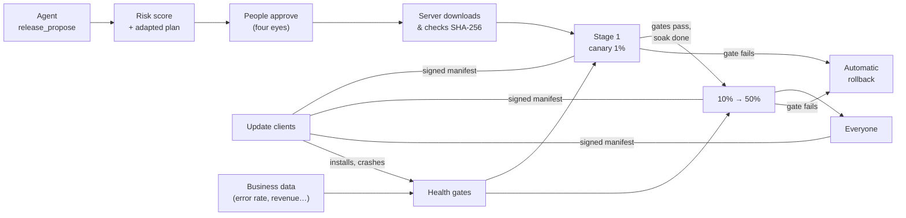
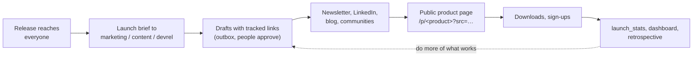

# Releases and distribution

Agents build software; this is how what they build reaches the people who
use it, safely. Agents **propose** releases, the server **scores the risk**
from facts and **adapts the rollout**, **people approve**, and the server
**rolls the release out in stages** while **health gates** watch it and
**roll it back on their own** when something breaks. Update clients receive
**signed manifests**; every release carries a signed **attestation** of
what it is, where it came from, and which agent and people stood behind it.



In the web UI: **Organisation → 🚀 Releases**. Once a release is out, the
[launch loop](#telling-people-about-it) gets it in front of developers and
businesses.

## Products

A product is something the organisation ships: a desktop app, a CLI, a
mobile app, a firmware image, a container image, a plugin. An admin creates
it (**+ Product**) with:

| Setting | What it does |
|---|---|
| `name` | `a-z`, `0-9`, `-`, `_`. Clients use it in URLs (`/dist/<name>/…`). |
| `departments` | Departments whose agents may propose releases (they get the `release_*` tools). |
| `repository` | `owner/name` on GitHub. With GitHub connected, the size of a change is read from GitHub, not taken from the agent. |
| `plan` | The rollout stages: `name`, `percent` of units, `soak_minutes`. Percentages grow and end at 100. Default: canary 1% (60 min), early 10% (120), half 50% (240), everyone. |
| `gates` | Health gates (below). A product without gates rolls out blind, and its releases score higher risk. |
| `approvals_required` | Distinct people who must approve a release (1 to 5). |
| `artifact_hosts` | Hosts artifacts may be downloaded from: `downloads.acme.com`, or `.github.com` for every subdomain. Nothing else is accepted, also not as a redirect target. |
| `webhook_url`, `webhook_secret` | Where rollout events are posted (your deploy system, chat), signed with HMAC-SHA256. |

Creating a product returns its **client token** once (only a hash is kept).
Update clients use it; it is not an operator token and grants nothing in
the operator API. **New client token** replaces it.

**❄ Freeze** (operators) starts a change freeze with a reason: no rollout
starts or moves to its next stage until the freeze is lifted. Health gates
still roll back a failing release during a freeze.

## Proposing a release

Agents of the product's departments call `release_propose`:

```json
{
  "product": "desktop-app",
  "version": "1.4.0",
  "commit": "3f2a9c1d",
  "notes": "Faster search.\n\n- Search index rebuilt in the background\n- Fixes #212",
  "artifacts": [{
    "name": "app-1.4.0-linux-x86_64.tar.gz", "platform": "linux-x86_64",
    "url": "https://github.com/acme/app/releases/download/v1.4.0/app-1.4.0-linux-x86_64.tar.gz",
    "sha256": "9f86d081884c7d659a2feaa0c55ad015a3bf4f1b2b0b822cd15d6c15b0f00a08",
    "size": 18734112
  }],
  "checks": [{ "name": "unit tests", "passed": true }, { "name": "e2e", "passed": true }],
  "changes": { "files_changed": 9, "lines_added": 410, "lines_removed": 95 },
  "sbom": { "bomFormat": "CycloneDX", "specVersion": "1.5", "components": [] },
  "risk": "low",
  "assessment": "Index rewrite, tested on large notebooks; no schema change."
}
```

People can propose too (`POST /api/v1/releases`); someone else approves.

* **Versions** are [semantic versions](https://semver.org) and only go up:
  a new version must be above every version the product used, including
  rolled-back ones. A rolled-back version is never offered again; the fix is
  a new version. Only a rejected release (never shipped) frees its version.
* **Artifacts** need the SHA-256 of the file and a URL on an allowed host.
* **Notes** are for the people who use the product.

The other tools: `release_products` (plans, gates, current version,
rollouts), `release_status` (status, stage, gate results, crash-free and
install-success rates, people's feedback), `release_revise` (after people
asked for changes; approvals start over), and `release_halt` (pause a
rollout now, with a reason). Agents cannot approve, start, resume, promote
or roll back. They can always halt: anyone may stop the line.

## Risk, from facts

The server scores every proposal from 0 to 100 and shows each factor, so
people can see *why* (the **Why** under the meter):

| Factor | Points |
|---|---|
| Version change | first release 20, major 25 (also a minor change below 1.0), minor 10, patch 3, pre-release 5 |
| Size of the change | unknown 8; up to 100 lines 0, 500: 5, 2000: 12, more: 20; over 50 files +5 |
| Checks | none reported 10; each failing check 25 (up to 50) |
| SBOM | none: 5 |
| Health gates | none: 15 |
| Track record | share of the last 10 finished releases that were rolled back × 30 |
| Time since the last release | over 60 days: 8 |
| Timing | Friday afternoon or the weekend (UTC): 10 |
| The proposer's judgement | rated high 15, medium 5 |

Below 30 is **low**, below 60 **medium**, otherwise **high**. The level
adapts the rollout of that release:

* **low**: the product's plan.
* **medium**: every stage soaks twice as long.
* **high**: three times as long, a **pilot** stage at a quarter of the first
  stage (at least 0.1%) goes first, and **one more approval** is needed.

The agent's own assessment is shown next to the score. It counts as one
factor, so an agent cannot talk a risky change down, but an agent that
knows of a risk can raise it.

## Approval

People see the notes, the artifacts and their digests, the checks, the SBOM,
the size of the change, the risk and the adapted plan. They **approve** the
revision they read, **send it back** with what should change (the agent
revises it, and approvals start over), or **reject** it. The agent is told
every decision.

* Approvals come from distinct people, and nobody approves a release they
  proposed (four eyes).
* An approval is for one revision. If the release changed since you read it,
  your approval is refused (409).
* Before an approval counts, the server **downloads every artifact** (from
  allowed hosts only, redirects included, at most 2 GiB) and checks its size
  and SHA-256. A mismatch refuses the approval: nobody approves bytes nobody
  checked.
* The last approval needed **starts the rollout**, unless a freeze or
  another rollout of the product is in the way. Then **▶ Start rollout**
  starts it later. A product has one rollout at a time; the database
  enforces it.

When the rollout starts, the server signs the release's
[attestation](#attestations).

## The rollout

Every installation of the product is a **unit**, with a stable id the
client makes (an install id, not a person). At each stage a unit is offered
the release if its **bucket** (SHA-256 of the release id and the unit,
0 to 9,999) is below the stage's percentage. A unit that got the release
keeps it as the rollout grows. Each release picks a different first 1%, so
the same users are not always the guinea pigs. Units outside the rollout are
offered the last released version.

On every heartbeat (each node; every step is claimed by exactly one node)
the server reads the health gates of every rollout:

* A gate **fails**: the release is **rolled back** immediately and
  automatically. Units that installed it are offered the previous version
  (with `"rollback": true`). The agent, the UI and the webhook are told why.
* A gate is **waiting** (too few units reported) or in **error** (its data
  source cannot be read): the rollout **holds**. An unreadable number never
  rolls back and never moves on.
* Every gate **passes** and the stage has soaked: the next stage. After the
  last stage the release is **released**.

People can **⏩ Next stage** (skip the rest of the soak; every gate must
pass), **⏸ Pause** (units keep what they were offered), **▶ Resume** (the
stage soaks again from now) and **↩ Roll back** (a rollout, or the newest
released version).

## Health gates

```json
{ "name": "crash-free", "metric": { "kind": "crash_free" },
  "comparator": ">=", "threshold": 0.99, "min_samples": 50 }
```

| `metric.kind` | The number |
|---|---|
| `crash_free` | Share of units on the release that reported no crash, from client reports. |
| `install_success` | Share of install attempts that worked. |
| `data` | A [business data source](MULTI_AGENT.md#business-data): `sql` (PostgreSQL, one SELECT) or `path` (HTTP API), and `field`, a column of the first row or a JSON pointer (`/data/0/rate`). `{version}`, `{release}` and `{since}` (when the rollout started) are filled in. |

`comparator` is `<`, `<=`, `>`, `>=` (or `lt`, `lte`, `gt`, `gte`).
`min_samples` is how many units must have reported before a client-report
gate counts.

A gate on your own numbers, for example the API error rate since the
rollout started:

```json
{ "name": "api errors", "comparator": "<", "threshold": 0.02,
  "metric": { "kind": "data", "source": "warehouse", "field": "rate",
    "sql": "SELECT avg((status >= 500)::int) AS rate FROM requests WHERE app_version = '{version}' AND at >= '{since}'" } }
```

## Update clients

Clients talk to `/dist` with the product's client token:

```sh
# Which version should this unit run?
curl -H "Authorization: Bearer $CLIENT_TOKEN" \
  "https://agentcore.example.com/dist/desktop-app/update?unit=$INSTALL_ID&current=1.3.2&platform=linux-x86_64"
```

```json
{
  "manifest": {
    "product": "desktop-app", "version": "1.4.0", "update": true, "rollback": false,
    "notes": "…", "commit": "3f2a9c1d",
    "artifacts": [{ "name": "…", "platform": "linux-x86_64", "url": "…", "sha256": "…", "size": 18734112 }],
    "status": "rolling_out", "stage": "canary", "percent": 1.0,
    "attestation": "/dist/desktop-app/releases/1.4.0/attestation",
    "issued_at": "…", "expires_at": "…"
  },
  "envelope": { "payloadType": "application/vnd.agentcore.update+json", "payload": "…", "signatures": [{ "keyid": "…", "sig": "…" }] }
}
```

`track=beta` offers the newest rolling-out release to every unit that asks
(early adopters who opt in). What a client should do:

1. Pin the public keys from `GET /dist/keys` (no token needed) when it is
   built or installed.
2. Verify the **envelope** ([DSSE](https://github.com/secure-systems-lab/dsse),
   Ed25519 over `DSSEv1 <len(type)> <type> <len(payload)> <payload>`) with a
   pinned key, and use the **decoded payload**, not the unsigned `manifest`
   copy next to it.
3. Refuse a manifest past its `expires_at` (24 hours), so an old manifest
   cannot be replayed to keep a unit on an old version.
4. Download the artifact for its platform and compare its SHA-256 before
   installing anything.
5. Report: `POST /dist/<product>/report` with
   `{"unit", "version", "event"}`, where `event` is `installed`,
   `install_failed`, `crash` or `healthy`. These reports feed the
   `crash_free` and `install_success` gates.

Unit ids are stored only as a hash (SHA-256 of the product and the unit).

## Attestations

When a rollout starts, the server signs an
[in-toto Statement v1](https://github.com/in-toto/attestation) as a DSSE
envelope (`application/vnd.in-toto+json`):

* `subject`: every artifact with its SHA-256;
* `predicateType`: `https://agentcore.dev/attestations/release/v1`;
* `predicate`: product, version, repository and commit, who proposed it,
  `ai_generated` (proposed by an agent), the people who approved it, the
  risk, the checks, the rollout plan, digests of the notes and the SBOM,
  and whether every artifact was verified.

Get it at `GET /api/v1/releases/{id}/attestation` (operators) or
`GET /dist/<product>/releases/<version>/attestation` (clients), and verify
it like a manifest. It records who and what stood behind a release that ran
on users' machines, also for an AI system.

## Signing keys

The first Ed25519 key is made on first use. Its private half is encrypted
with the master key in PostgreSQL. **Rotate** with
`POST /api/v1/releases/keys/rotate` (admin): the new key signs from then
on, and retired keys stay published at `/dist/keys` so earlier signatures
still verify. Ship clients with the current keys and update them with
your releases.

## Webhooks

Every step (`started`, `advanced`, `released`, `paused`, `resumed`,
`rolled_back`) is posted to the product's webhook as JSON (`event`,
`product`, `release_id`, `version`, `status`, `stage`, `percent`,
`reason`, `text`, `at`). The `X-Agentcore-Event` header names the event.
With a webhook key, `X-Agentcore-Signature: sha256=<hex>` is the
HMAC-SHA256 of the body; compare it in constant time before you act on it.
Redirects are not followed.

Use it to drive what agentcore does not do itself: deploying a server
release to a percentage of your fleet, publishing to an app store, posting
to a channel.

## Telling people about it

A release nobody hears of reaches nobody. agentcore closes the loop from
"released" to "people know, try it and sign up", with people approving
everything that goes out:



### Launch settings

Per product (**Launch settings…** under the product, admin):

| Setting | What it does |
|---|---|
| `public` | Turns on the product page at `/p/<name>`. |
| `tagline` | One line on the page and in the brief. |
| `audience` | `developers`, `business` or `both`: shapes what the brief asks for and where. |
| `pitch` | Positioning for the people and agents who announce it (the problem, for whom, why it is different). Not shown publicly. |
| `website` | Linked from the page. |
| `announce_departments` | Departments that announce its releases; their workers get the `launch_*` tools and a "Telling people about the products" section in their prompt. |
| `announce_patches` | Also brief them on patch releases (by default only first, major and minor releases). |

Agents get new tools when their next session starts (a message wakes a
sleeping agent into a new session; restart one that is running).

### The public page

`/p/<product>` shows the tagline and description, the current version with a
download button per platform and each file's SHA-256, the changelog of
released versions (never a canary), an Atom feed (`/p/<product>/feed.xml`),
and a sign-up form for news. Everything on it is escaped text (release
notes cannot inject HTML), the page sends a strict Content-Security-Policy,
and its footer says that AI agents wrote parts of the software and its notes
and that people approved every release. Products without `public` answer
404.

Downloads go through `/p/<product>/download/<file>`, which counts the
download and redirects to the artifact.

### Sign-ups

People give their email, say whether they are a developer or here for a
business, optionally their company, and tick a consent box ("Send me news
about … I can unsubscribe at any time."); the exact words are stored with
the address. A hidden field catches most bots; signing up twice changes
nothing and gives the same answer, so nobody learns who is on the list.
Every sign-up gets an unsubscribe link (`/p/<product>/unsubscribe?token=…`);
it shows a button, because mail scanners open links.

agentcore does not send newsletters itself. Sign-ups and unsubscribes are
posted to the product's webhook (`subscribed` with email, segment, company,
source, consent and the unsubscribe link; `unsubscribed` with the email),
signed like every other event, so Zapier, Make or n8n can add them to
Buttondown, Mailchimp, Resend or your CRM, which confirm the address
(double opt-in) and handle sending. Admins can also download the list as
CSV (`GET /api/v1/releases/products/{id}/subscribers.csv`; every export is
in the admin log; cells are escaped so spreadsheets never run them as
formulas).

### Tracked links

Add `?src=<channel>` to links to the page: `newsletter`, `linkedin`, `hn`,
`devto`, `partner-acme`. Visits, downloads and sign-ups are counted per
product, day and source: no cookies, no IP addresses, nothing per person.
Sources are lowercased `a-z 0-9 - _ .` up to 40 characters; anything else
counts as `other`, no `src` as `direct`, and after 200 sources per product
new ones count as `other`.

### The launch brief

When a release reaches everyone (and it is the first, a major or a minor
release, or `announce_patches` is on), each announcing department gets a
message:

> Launch brief: kit 2.1.0 is released to everyone. It is a minor version
> with new features. Tagline, positioning, audience, the release notes, the
> product page and example tracked links, and what works for the audience:
> for developers what they can do now, a short example, precise and modest
> words, the changelog and developer communities; for businesses the
> problem, the outcome and a next step on the newsletter and LinkedIn;
> separate drafts for both.

The agents draft into the [outbox](MULTI_AGENT.md#talking-to-the-outside-world),
where a person approves, edits, sends back or rejects every message.
Communities such as Hacker News, Reddit, Discord and forums do not want
automated or AI-written posts: agents prepare those drafts, and a person
posts them in their own name. Agents are told never to invent customers,
numbers or quotes and to claim only what the release notes say.

The tools:

| Tool | What |
|---|---|
| `launch_products` | The products the department announces: tagline, description, positioning, audience, website, page, current version and its notes, subscribers. |
| `launch_link` | A tracked link for one `source`. |
| `launch_stats` | Visits, downloads and sign-ups per source over `days` (default 30), per day, and subscribers by segment. |

The **Developer Relations** department template (an advocate and an
educator) is made for this; Marketing, Content and Communications work too.

### Results

Each product in the Releases view shows its page, visits, downloads,
sign-ups and subscribers (developers and businesses) over 30 days, and the
sources that brought them. `GET /api/v1/org/metrics` and the
retrospective's `insights_metrics` include the same per public product
(`launch`), and the dashboard flags a product whose release nobody visited.

## Signals and the retrospective

The dashboard flags releases rolled back in the period (high), releases
waiting more than a day for approval, and paused rollouts. The
retrospective sees the same through `insights_metrics`.

## API

Operator API (`/api/v1`, operator token; changing products needs admin):

| Method and path | What |
|---|---|
| `GET /releases/products`, `POST` (admin) | Products with their current version and rollout; create (returns the client token once). |
| `PUT`, `DELETE /releases/products/{id}` (admin) | Change or delete (not during a rollout). |
| `POST /releases/products/{id}/token` (admin) | A new client token. |
| `PUT`, `DELETE /releases/products/{id}/freeze` | Start (`{"reason"}`) or lift a change freeze. |
| `GET /releases?product=&status=`, `POST /releases` | List; a person proposes. |
| `GET /releases/{id}` | A release with client report counts, crash-free and install-success rates. |
| `PUT /releases/{id}` | A person revises (`revision` they read, the fields, `note`). |
| `POST /releases/{id}/approve` | `{"revision"}`: verify artifacts, approve; starts the rollout on the last approval. |
| `POST /releases/{id}/start` | Start a fully approved release (after a freeze). |
| `POST /releases/{id}/changes`, `/reject` | `{"text"}`: send back, reject. |
| `POST /releases/{id}/pause`, `/resume`, `/promote`, `/rollback` | Control the rollout (`pause`, `rollback`: `{"text"}`). |
| `GET /releases/{id}/attestation` | The signed attestation. |
| `GET /releases/keys`, `POST /releases/keys/rotate` (admin) | Signing keys. |
| `GET /releases/products/{id}/launch?days=` | Visits, downloads and sign-ups per source, subscribers. |
| `GET /releases/products/{id}/subscribers.csv` (admin) | Subscribers as CSV (logged). |

Public pages (no token; only products with `public`): `GET /p/{product}`,
`GET /p/{product}/feed.xml`, `GET /p/{product}/download/{file}`,
`POST /p/{product}/subscribe`, `GET`/`POST /p/{product}/unsubscribe`.

Clients (`/dist`, product client token): `GET /dist/keys` (no token),
`GET /dist/{product}/update`, `POST /dist/{product}/report`,
`GET /dist/{product}/releases/{version}/attestation`.

## Security notes

* Agents only propose and halt. Starting, moving on, resuming and rolling
  back are people's (or the gates') decisions, and every one is in the admin
  log with who did it.
* The server only downloads from allowed hosts, follows redirects only to
  allowed hosts, and never returns downloaded content to anyone.
* Anyone with a client token can send reports. Fake crashes can at worst
  roll a release back (the safe direction). Fake healthy reports could hurry
  a bad release, so set `min_samples` well above what one person could fake,
  add gates on server-side data you trust (error rates, support tickets),
  and rotate a token that leaked.
* Pin signing keys in clients; never fetch them over the same channel as
  the manifest without pinning.
